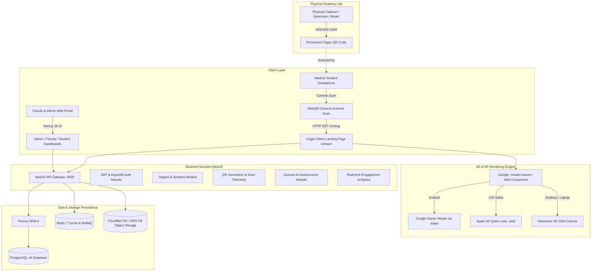

# AnatoScan AR — System Architecture

## Architectural Highlights
1. **Permanent Slug Decoupling:** QR codes store unchanging endpoints (`/o/heart`). The underlying 3D models, textures, or educational modules can be updated by faculty without re-printing physical specimen labels.
2. **Zero-App-Install AR:** Uses Google `<model-viewer>` to seamlessly trigger native iOS QuickLook and Android SceneViewer AR experiences directly from the mobile browser without requiring students to install custom mobile apps.
3. **Institutional RBAC:** 4 tiered personas (Super Admin, Faculty Anatomist, Medical Student, Public Visitor).
