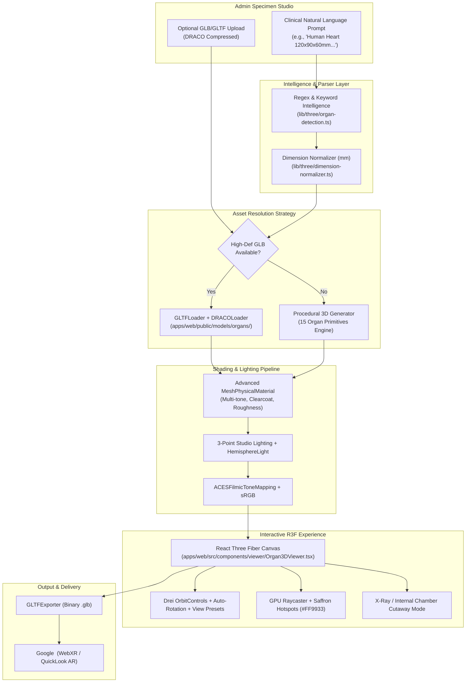

# ANAQR Master 3D Anatomy Engine: Complete 15-Organ Implementation Plan

> **Standard:** ANAQR Premium Medical-Grade Specification  
> **Core Architecture:** Hybrid Engine (GLTF/DRACO Loader for High-Fidelity Anatomical Assets + Procedural Three.js Primitives for Instant Generation)  
> **Rendering Stack:** Next.js 15, React 18, `@react-three/fiber` v8, `@react-three/drei` v9, Three.js `MeshPhysicalMaterial`, Studio 3-Point Lighting, ACESFilmicToneMapping.

---

## 1. System Architecture: The Hybrid Anatomy Engine

ANAQR delivers both instant procedural 3D organ generation from clinical descriptions and high-fidelity GLTF/GLB anatomical rendering with seamless fallback:



---

## 2. Complete 15-Organ Master Catalog & Normalized Dimensions

Every organ conforms to clinical metric standards, validated color palettes, multi-structure geometries, and standardized anatomical hotspots:

| # | Organ | Dimensions (L × W × H / D) | Procedural Geometry Recipe | Multi-Tone Palette (Hex) | Key Hotspots (Anatomical Landmarks) |
|---|---|---|---|---|---|
| **1** | **Heart** | $120 \times 90 \times 60\text{ mm}$ | Deformed sphere + inverted cone apex + 4 chamber cutaways + CatmullRom tube aorta, pulmonary trunk, & coronaries | Myocardium: `#A8323E`<br>Aorta: `#C84643`<br>Pulmonary: `#527FA8`<br>Vena Cava: `#456D96` | Aortic Arch, Pulmonary Trunk, SVC/IVC, Right/Left Atria, Right/Left Ventricles, Coronary Arteries |
| **2** | **Lungs** | $240 \times 180 \times 280\text{ mm}$ (W×D×H) | Bilateral lobed spheres (3 right, 2 left with cardiac notch) + ringed trachea tube + bifurcated bronchial tree | Parenchyma: `#D98C8C`<br>Trachea/Cartilage: `#D9C3B0`<br>Pulm. Vessels: `#4A7EBB` | Trachea, Carina, Right Superior/Middle/Inferior Lobes, Left Superior/Inferior Lobes, Cardiac Notch |
| **3** | **Kidney** | $110 \times 60 \times 40\text{ mm}$ | 24-point Lathe sinusoidal profile with medial hilum concavity + renal pelvis + CatmullRom ureter & renal vessels | Cortex: `#8C4A4A`<br>Ureter: `#E8C275`<br>Renal Artery: `#C0392B`<br>Renal Vein: `#3B6998` | Renal Cortex, Renal Medulla, Renal Pelvis, Renal Artery, Renal Vein, Ureter |
| **4** | **Liver** | $160 \times 220 \times 120\text{ mm}$ (L×W×H) | Asymmetric displaced wedge ellipsoid (massive right lobe, tapered left lobe) + falciform groove + IVC tube + gallbladder | Hepatic tissue: `#873E23`<br>Gallbladder: `#3E6B27`<br>IVC: `#3B6998`<br>Portal Vein: `#5A3E7A` | Right Lobe, Left Lobe, Falciform Ligament, Gallbladder, Inferior Vena Cava, Porta Hepatis |
| **5** | **Brain** | $160 \times 140 \times 120\text{ mm}$ | Dual hemispheres with trigonometric noise gyri/sulci + posterior horizontally striated cerebellum + brainstem tube | Cerebrum: `#D4A5A5`<br>Cerebellum: `#B88A8A`<br>Brainstem: `#E0C4B0`<br>Vasculature: `#C0392B` | Frontal Lobe, Parietal Lobe, Occipital Lobe, Temporal Lobe, Cerebellum, Pons, Medulla Oblongata |
| **6** | **Stomach** | $250 \times 120 \times 80\text{ mm}$ | Extruded J-shaped variable-radius tube + superior fundus dome + terminal pyloric sphincter | Gastric wall: `#C46D6D`<br>Fundus: `#B55E5E`<br>Esophageal junction: `#D49B9B` | Cardia, Fundus, Greater Curvature, Lesser Curvature, Pylorus, Duodenal Junction |
| **7** | **Eye** | Eyeball: $\varnothing 24\text{ mm}$, Optic Nerve: $40\text{ mm}$ | Sphere (sclera) + anterior transparent cornea dome + torus iris + pupil aperture + posterior optic nerve tube | Sclera: `#F4F1EA`<br>Iris: `#2E5B88`<br>Cornea: `#E8F4F8` (translucent)<br>Optic Nerve: `#D7C4A8` | Cornea, Iris, Pupil, Sclera, Lens, Optic Nerve, Macula |
| **8** | **Large Intestine** | $200 \times 150 \times 300\text{ mm}$ (W×D×H) | Haustrated segmented perimeter TubeGeometry + cecum pouch + appendix tube + rectum | Colon: `#BC7A65`<br>Taeniae Coli: `#9E5E4A`<br>Appendix: `#A86350` | Cecum, Vermiform Appendix, Ascending Colon, Transverse Colon, Descending Colon, Sigmoid Colon, Rectum |
| **9** | **Small Intestine** | $180 \times 160 \times 100\text{ mm}$ | Tightly packed helical 3D CatmullRom splines with continuous mucosal loops | Jejunum: `#D48372`<br>Ileum: `#C6705F`<br>Mesentery: `#E6C594` | Duodenum, Jejunum, Ileum, Mesenteric Border |
| **10** | **Pancreas** | $150 \times 40 \times 25\text{ mm}$ | Lobulated elongated comma-shaped mesh + main pancreatic duct tube | Parenchyma: `#E0B06B`<br>Pancreatic Duct: `#F0E6D2`<br>Splenic Vessels: `#C0392B` | Head, Uncinate Process, Neck, Body, Tail, Main Pancreatic Duct |
| **11** | **Spleen** | $120 \times 70 \times 40\text{ mm}$ | Smooth tetrahedral convex-concave ellipsoid with notched anterior border + hilar vessels | Parenchyma: `#6B2D38`<br>Splenic Artery: `#C0392B`<br>Splenic Vein: `#3B6998` | Diaphragmatic Surface, Visceral Surface, Splenic Hilum, Anterior Notch |
| **12** | **Urinary Bladder** | $100 \times 80 \times 70\text{ mm}$ | Expandable tetrahedral hollow ellipsoid + dual superior ureter inlets + inferior urethra tube | Detrusor Muscle: `#BD6B6B`<br>Ureters: `#E8C275`<br>Trigone: `#A65353` | Apex, Fundus, Body, Neck, Trigone, Ureteric Orifices |
| **13** | **Thyroid Gland** | $50 \times 60 \times 20\text{ mm}$ | Butterfly-shaped bilateral lobes connected by a thin central isthmus across the trachea | Thyroid tissue: `#944242`<br>Trachea: `#D9C3B0`<br>Thyroid Arteries: `#C0392B` | Right Lobe, Left Lobe, Isthmus, Pyramidal Lobe (accessory), Superior Thyroid Artery |
| **14** | **Femur** | $450 \times 80 \times 80\text{ mm}$ | Cylindrical shaft with anterior bow + proximal femoral head ball, neck, and trochanters + distal condyles | Compact Bone: `#EAE3D2`<br>Articular Cartilage: `#D6E5EA`<br>Spongy Bone: `#D2C4A8` | Femoral Head, Neck, Greater Trochanter, Lesser Trochanter, Shaft (Diaphysis), Medial/Lateral Condyles |
| **15** | **Skeletal Muscle (Biceps)** | $220 \times 60 \times 50\text{ mm}$ | Spindle-shaped fusiform belly (capsule + fiber tubes) tapering into glistening white proximal & distal tendons | Muscle Belly: `#A63A42`<br>Tendon: `#E8ECEF`<br>Aponeurosis: `#DCE0E3` | Long Head Belly, Short Head Belly, Proximal Tendons, Distal Bicipital Tendon, Musculotendinous Junction |

---

## 3. Advanced PBR Shading & Multi-Tone Materials

We migrate from basic materials to Three.js `MeshPhysicalMaterial`, providing subsurface clearcoat, micro-roughness, and multi-layered tissue visualization:

```typescript
// apps/web/src/lib/three/organ-materials.ts
import * as THREE from 'three';

export interface OrganMaterialConfig {
  baseColor: string;
  roughness?: number;
  metalness?: number;
  clearcoat?: number;
  clearcoatRoughness?: number;
  transmission?: number;
  opacity?: number;
  transparent?: boolean;
  xray?: boolean;
}

export function createPremiumTissueMaterial(config: OrganMaterialConfig): THREE.MeshPhysicalMaterial {
  const isXray = config.xray || false;
  return new THREE.MeshPhysicalMaterial({
    color: new THREE.Color(config.baseColor),
    roughness: config.roughness ?? 0.58,
    metalness: config.metalness ?? 0.02,
    clearcoat: isXray ? 0.0 : (config.clearcoat ?? 0.35),
    clearcoatRoughness: config.clearcoatRoughness ?? 0.25,
    reflectivity: 0.45,
    transparent: isXray || config.transparent || false,
    opacity: isXray ? 0.28 : (config.opacity ?? 1.0),
    depthWrite: !isXray,
    side: THREE.DoubleSide,
    toneMapped: true,
  });
}

export function createVesselMaterial(color: string, isArterial = true): THREE.MeshPhysicalMaterial {
  return new THREE.MeshPhysicalMaterial({
    color: new THREE.Color(color),
    roughness: 0.35,
    metalness: 0.08,
    clearcoat: 0.45,
    clearcoatRoughness: 0.15,
  });
}

export function createCartilageMaterial(color = '#D6E5EA'): THREE.MeshPhysicalMaterial {
  return new THREE.MeshPhysicalMaterial({
    color: new THREE.Color(color),
    roughness: 0.28,
    metalness: 0.02,
    clearcoat: 0.6,
    transmission: 0.15, // Soft translucent edge
    transparent: true,
    opacity: 0.92,
  });
}
```

---

## 4. Professional Lighting, Camera, & Studio Environment

The studio environment provides medical-grade visualization with ACESFilmicToneMapping and 3-point illumination:

```tsx
// Inside R3F Canvas (<Organ3DViewer />)
<Canvas
  dpr={[1, 2]}
  gl={{
    antialias: true,
    toneMapping: THREE.ACESFilmicToneMapping,
    toneMappingExposure: 1.1,
    outputColorSpace: THREE.SRGBColorSpace,
  }}
  camera={{ position: [0, 0.25, 1.2], fov: 42 }}
  className="bg-[#050B1D]"
>
  {/* Natural Ambient Illumination */}
  <hemisphereLight
    skyColor={new THREE.Color('#DFE8F5')}
    groundColor={new THREE.Color('#0A1128')}
    intensity={0.65}
  />

  {/* Key Light (Anterior-Superior) */}
  <directionalLight
    position={[2.5, 4.0, 3.5]}
    intensity={1.25}
    castShadow
    shadow-mapSize={[1024, 1024]}
  />

  {/* Fill Light (Soft Lateral Depth) */}
  <directionalLight position={[-3.0, 1.5, -2.0]} intensity={0.45} />

  {/* Rim / Back Light (Silhouettes and Edge Contours) */}
  <directionalLight position={[0, -2.5, -3.0]} intensity={0.3} />

  {/* Floor Ambient Contact Grid */}
  <Grid
    position={[0, -0.4, 0]}
    args={[1.2, 1.2]}
    cellSize={0.05}
    sectionSize={0.2}
    cellColor="#1E293B"
    sectionColor="#334155"
    fadeDistance={3}
    infiniteGrid
  />

  {/* Smooth Interaction & View Presets */}
  <OrbitControls
    enableDamping
    dampingFactor={0.06}
    autoRotate={autoRotate}
    autoRotateSpeed={1.2}
    maxDistance={2.5}
    minDistance={0.4}
  />
</Canvas>
```

---

## 5. Normalized Coordinate Hotspot & Raycast System

Landmarks are defined using normalized bounding-box coordinates $([-1..1])$ so that dimension changes immediately scale hotspots accurately:

```typescript
// apps/web/src/lib/three/types.ts
export interface AnatomicalHotspot {
  id: string;
  name: string;
  normalizedPosition: [number, number, number]; // [nx, ny, nz] between -1 and 1
  description: string;
  clinicalFunction: string;
  system: string;
}

export function computeWorldPosition(
  normalized: [number, number, number],
  bounds: { length: number; width: number; height: number }
): [number, number, number] {
  return [
    normalized[0] * (bounds.width / 2),
    normalized[1] * (bounds.height / 2),
    normalized[2] * (bounds.length / 2),
  ];
}
```

```tsx
// Hotspot Component inside R3F
<group position={worldPos} onClick={(e) => { e.stopPropagation(); onSelect(hotspot); }}>
  {/* Saffron Pulsing Marker */}
  <mesh>
    <sphereGeometry args={[0.012, 24, 24]} />
    <meshStandardMaterial
      color="#FF9933"
      emissive="#FF9933"
      emissiveIntensity={isSelected ? 1.2 : 0.6}
      toneMapped={false}
    />
  </mesh>

  {/* Floating Label */}
  <Html distanceFactor={0.55} position={[0, 0.025, 0]}>
    <div className={`px-2.5 py-1 rounded-full text-xs font-semibold backdrop-blur shadow-xl transition-all cursor-pointer ${
      isSelected 
        ? 'bg-amber-500 text-slate-950 ring-2 ring-amber-300 scale-105' 
        : 'bg-slate-900/90 text-amber-200 border border-amber-500/30 hover:border-amber-400'
    }`}>
      {hotspot.name}
    </div>
  </Html>
</group>
```

---

## 6. Hybrid Loading & Asset Resolution Strategy

```typescript
// apps/web/src/components/viewer/OrganModelResolver.tsx
import React, { Suspense } from 'react';
import { useGLTF } from '@react-three/drei';
import { getProceduralOrganGenerator } from '@/lib/three/organ-models';

interface Props {
  organSlug: string;
  dimensions: { lengthMm: number; widthMm: number; heightMm: number };
  xray: boolean;
  modelUrl?: string | null;
}

function GLTFOrganModel({ url }: { url: string }) {
  const { scene } = useGLTF(url);
  return <primitive object={scene.clone()} />;
}

export function OrganModelResolver({ organSlug, dimensions, xray, modelUrl }: Props) {
  // 1. If high-fidelity GLB model is available, render via GLTFLoader
  if (modelUrl) {
    return (
      <Suspense fallback={null}>
        <GLTFOrganModel url={modelUrl} />
      </Suspense>
    );
  }

  // 2. Procedural Three.js fallback
  const generator = getProceduralOrganGenerator(organSlug);
  if (!generator) return null;

  const organGroup = generator(dimensions, { xray });
  return <primitive object={organGroup} />;
}
```

---

## 7. Implementation Roadmap & Execution Checklist

| Phase | Milestone | Scope | Deliverables |
|---|---|---|---|
| **Phase 1** | **Core Packages & Architecture Setup** | Install `@react-three/fiber` & `@react-three/drei`. Create `types.ts`, `organ-materials.ts`, and `dimension-normalizer.ts`. | Monorepo builds cleanly with typed PBR tissue materials. |
| **Phase 2** | **15-Organ Procedural Generator Library** | Implement individual generator modules under `apps/web/src/lib/three/organ-models/` for all 15 organs conforming to normalized dimensions. | 15 procedural templates exporting valid `THREE.Group` meshes. |
| **Phase 3** | **NLP Detection & Keyword Scoring** | Implement upgraded `organ-detection.ts` supporting all 15 organs, synonyms, and metric extraction (`mm`, `cm`). | Automatic extraction of organ type and dimensions from natural text. |
| **Phase 4** | **Master R3F Viewer & Studio Preview** | Build `Organ3DViewer.tsx` and `Organ3DPreview.tsx` with studio lighting, camera presets (Anterior, Posterior, Superior), and auto-orbit. | Smooth WebGL rendering with dark navy background `#050B1D`. |
| **Phase 5** | **Interactive Hotspot & X-Ray System** | Raycast placement, saffron glowing markers, interactive information card modal, and cutaway/X-Ray toggle. | Real-time structure selection, inspection, and label display. |
| **Phase 6** | **GLB Exporter & AR Pipeline** | Binary `.glb` export via `GLTFExporter`, static persistence to `public/models/organs/[slug].glb`, and `<model-viewer>` AR hookup. | Models open directly in Android Scene Viewer and iOS Quick Look. |
| **Phase 7** | **Admin Specimen Studio UI** | Embed studio preview in `/admin` organ management page with live text-to-3D updates, dimension sliders, and export button. | Production-ready admin tool for creating and publishing organs. |

---

## 8. Mobile AR & Performance Budget

- **Draw Calls:** Maintained under 25 draw calls per procedural organ by batching materials.
- **Polycount:** Kept under 45,000 triangles per organ for smooth 60 FPS performance on mobile devices.
- **Memory Disposal:** All geometries and materials invoke `.dispose()` upon unmounting or re-generating models to avoid WebGL memory leaks.
