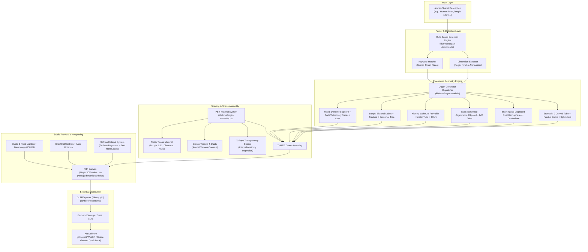

# AnaQR Procedural 3D Organ Generation Engine: 10/10 Implementation Plan

> **Objective:** Deliver a zero-dependency, offline, procedural 3D anatomy modeling engine for AnaQR using Three.js geometry primitives (`TubeGeometry`, `LatheGeometry`, `ExtrudeGeometry`, deformed spheres, and capsules), React Three Fiber (R3F), and rule-based NLP parsing. This enables faculty and administrators to generate high-fidelity, interactive 3D organs, attach anatomical hotspots, toggle X-ray views, and export production `.glb` assets for browser-based AR without requiring any external AI API keys or 3D modeling software.

---

## 1. System Architecture & End-to-End Workflow

The procedural engine follows a clean modular pipeline:



---

## 2. Technology Stack & Dependencies

### Package Additions (`apps/web`)

```bash
cd /home/dhiraj/Downloads/AnaQR/AnaQR/apps/web
pnpm add @react-three/fiber@^8.17.10 @react-three/drei@^9.114.0
```

> [!NOTE]
> `three` (`^0.168.0`) and `@types/three` (`^0.168.0`) are already present in `apps/web/package.json`. React 18 (`^18.3.1`) is pinned, ensuring 100% stable compatibility with R3F v8 and `@react-three/drei` v9.

### SSR Isolation Strategy
Since Three.js and WebGL require browser `window` and canvas contexts, all R3F preview components must be dynamically imported with `ssr: false`:

```tsx
// apps/web/src/components/admin/organ-preview-wrapper.tsx
import dynamic from 'next/dynamic';

export const Organ3DPreview = dynamic(
  () => import('./Organ3DPreview'),
  {
    ssr: false,
    loading: () => (
      <div className="h-[520px] w-full rounded-2xl bg-[#050B1D] flex items-center justify-center text-slate-400">
        <span className="animate-pulse">Initializing WebGL 3D Studio...</span>
      </div>
    )
  }
);
```

---

## 3. Directory Layout & Module Specifications

```text
apps/web/src/lib/three/
├── organ-materials.ts         # PBR materials (matte tissue, glossy vessels, X-ray mode)
├── organ-detection.ts         # Regex dimension parser + keyword score evaluator
├── exporter.ts                # Client-side GLTFExporter to .glb ArrayBuffer / Blob
├── types.ts                   # Dimension interfaces, hotspot schemas, organ types
└── organ-models/
    ├── index.ts               # Registry & factory dispatcher
    ├── heart.ts               # 4-chamber body, aorta, pulmonary artery, coronaries, apex
    ├── lungs.ts               # Bilateral lobes, trachea, primary & secondary bronchi
    ├── kidney.ts              # Lathe renal body, renal pelvis, renal artery, ureter
    ├── liver.ts               # Deformed dual lobes, gallbladder, IVC, portal vein
    ├── brain.ts               # Gyri/sulci displaced hemispheres, cerebellum, pons
    └── stomach.ts             # J-curve TubeGeometry, fundus dome, pyloric sphincter

apps/web/src/components/admin/
├── Organ3DPreview.tsx         # R3F Canvas with lighting, grid, orbit, hotspots, X-Ray
├── OrganHotspotManager.tsx    # List and placement controller for organ landmarks
└── OrganStudioModal.tsx       # Integrated admin modal: text prompt -> 3D -> GLB upload
```

---

## 4. MVP Procedural Organ Geometric Specifications

### 1. Heart (`heart.ts`)
- **Base Body:** Scaled `SphereGeometry(0.5, 64, 64)` flattened anteroposteriorly to represent ventricular mass.
- **Apex:** Inverted `ConeGeometry(0.18, 0.28, 32)` positioned at `-height * 0.48`.
- **Aortic Arch:** `CatmullRomCurve3` tube (`TubeGeometry`, radius `0.035`) sweeping superiorly and curving leftward.
- **Pulmonary Trunk:** Bifurcating `TubeGeometry` crossing anterior to the aorta in cyan-blue `#4A7EBB`.
- **Coronary Arteries:** 5 procedural branching curves hugging the myocardial surface with `#D9534F` tone.
- **Vena Cava:** Superior & inferior venous inflow cylinders with `#2980B9` finish.

### 2. Lungs (`lungs.ts`)
- **Left Lung:** 2-lobed deformed sphere with cardiac notch concavity (`scale: [0.40, height, 0.35]`).
- **Right Lung:** 3-lobed deformed sphere (`scale: [0.44, height, 0.37]`).
- **Trachea:** Corrugated cylindrical tube (`TubeGeometry`) with cartilaginous ring segmentation in `#D9C3B0`.
- **Bronchial Tree:** Bifurcated primary bronchi angled at $35^\circ$ right and $45^\circ$ left, with secondary branching tubes.

### 3. Kidney (`kidney.ts`)
- **Renal Body:** `LatheGeometry` using 24 sinusoidal points:
  $$x(t) = \sin(t \cdot \pi) \cdot 0.5, \quad y(t) = \cos(t \cdot \pi) \cdot 0.5$$
  deformed with a lateral medial indentation (renal hilum).
- **Renal Pelvis & Ureter:** Downward curving `TubeGeometry` in urinary gold `#E8C275`.
- **Renal Artery & Vein:** Dual branching tubes entering the hilum in crimson `#C0392B` and cobalt `#2980B9`.

### 4. Liver (`liver.ts`)
- **Right & Left Lobes:** Asymmetric ellipsoid generated via custom vertex-deformed geometry; right lobe is thick and rounded, tapering sharply into the triangular left lobe.
- **Falciform Ligament Line:** Superficial subtle groove extrusion along the anterior-superior border.
- **Vascular Hilum:** Inferior vena cava groove tube and hepatic portal vein trunk.
- **Gallbladder:** Smooth pear-shaped ellipsoid nestled in the visceral fossa with hepatic green tint `#2E7D32`.

### 5. Brain (`brain.ts`)
- **Cerebral Hemispheres:** Dual spheres separated by longitudinal fissure ($x = \pm 0.045$), whose vertices are displaced using a deterministic trigonometric noise function:
  $$r' = r + 0.025 \cdot \sin(18\theta) \cdot \cos(18\phi)$$
  yielding naturalistic gyri (ridges) and sulci (grooves).
- **Cerebellum:** Posterior horizontally striate ellipsoid resting inferior to the occipital lobes.
- **Brainstem:** Smooth cylindrical tube descending from the diencephalon to form the pons and medulla oblongata.

### 6. Stomach (`stomach.ts`)
- **Gastric Body:** Extruded J-shaped `CatmullRomCurve3` spline via `TubeGeometry` with varying radius along the spline (wider at fundus/corpus, narrow at pylorus).
- **Fundus:** Hemispherical dome capping the superior pole above the cardiac notch.
- **Duodenal Cap:** Terminal tapered tube exiting through the pyloric sphincter.

---

## 5. PBR Shading, Lighting & X-Ray Shader System

```typescript
// apps/web/src/lib/three/organ-materials.ts
import * as THREE from 'three';

export interface MaterialOptions {
  xray?: boolean;
  wireframe?: boolean;
}

export function createOrganMaterial(color: string, options: MaterialOptions = {}) {
  return new THREE.MeshStandardMaterial({
    color,
    roughness: 0.62,
    metalness: 0.04,
    clearcoat: 0.25,
    clearcoatRoughness: 0.2,
    transparent: options.xray || false,
    opacity: options.xray ? 0.32 : 1.0,
    depthWrite: !options.xray,
    wireframe: options.wireframe || false,
    side: THREE.DoubleSide
  });
}

export function createVesselMaterial(color: string, options: MaterialOptions = {}) {
  return new THREE.MeshStandardMaterial({
    color,
    roughness: 0.38,
    metalness: 0.08,
    transparent: options.xray || false,
    opacity: options.xray ? 0.85 : 1.0,
  });
}
```

> [!TIP]
> In **X-Ray Mode**, the outer organ mass drops to `opacity: 0.32` while coronary arteries, bronchial trees, and internal chambers remain opaque (`opacity: 0.85`), providing instant anatomical clarity.

---

## 6. Saffron Interactive Hotspot System

Hotspots are positioned in 3D local coordinate space and display responsive floating UI cards via `@react-three/drei` `<Html />`:

```tsx
// Inside R3F Canvas
{hotspots.map((h) => (
  <group key={h.id} position={[h.x, h.y, h.z]}>
    {/* Pulsing Saffron Marker */}
    <mesh>
      <sphereGeometry args={[0.012, 16, 16]} />
      <meshStandardMaterial
        color="#FF9933"
        emissive="#FF9933"
        emissiveIntensity={0.6}
        toneMapped={false}
      />
    </mesh>

    {/* Floating Tag */}
    <Html distanceFactor={0.6} position={[0, 0.02, 0]}>
      <div className="pointer-events-auto flex items-center gap-1.5 px-2.5 py-1 rounded-full bg-slate-900/90 text-white text-xs border border-amber-500/40 shadow-lg backdrop-blur whitespace-nowrap">
        <span className="w-1.5 h-1.5 rounded-full bg-amber-400 animate-ping" />
        <span className="font-semibold text-amber-200">{h.label}</span>
      </div>
    </Html>
  </group>
))}
```

---

## 7. Model Serialization & AR Export Pipeline

```typescript
// apps/web/src/lib/three/exporter.ts
import * as THREE from 'three';
import { GLTFExporter } from 'three/addons/exporters/GLTFExporter.js';

export async function exportOrganToGLB(scene: THREE.Object3D): Promise<Blob> {
  const exporter = new GLTFExporter();
  return new Promise((resolve, reject) => {
    exporter.parse(
      scene,
      (gltf) => {
        const blob = new Blob([gltf as ArrayBuffer], { type: 'model/gltf-binary' });
        resolve(blob);
      },
      (error) => reject(error),
      {
        binary: true,
        onlyVisible: true,
        embedImages: true
      }
    );
  });
}
```

Once exported as a `.glb` Blob:
1. The admin clicks **"Publish to AR"**.
2. The blob is sent to `POST /api/v1/organs/:id/model` or saved in `public/models/organs/[slug].glb`.
3. The existing `<model-viewer>` component (`apps/web/src/components/viewer/model-viewer.tsx`) immediately renders it with Android Scene Viewer and iOS Quick Look support.

---

## 8. Detailed 7-Phase Execution Plan

| Phase | Milestone | Deliverables | Verification Criteria |
|---|---|---|---|
| **Phase 1** | **Dependencies & Types** | Install `@react-three/fiber` & `@react-three/drei`; create `types.ts` & `organ-materials.ts`. | Clean build with `pnpm --filter web build` without type errors. |
| **Phase 2** | **Procedural 6-Organ Library** | Implement `heart.ts`, `lungs.ts`, `kidney.ts`, `liver.ts`, `brain.ts`, `stomach.ts`. | Each generator outputs a valid `THREE.Group` with correct bounds and PBR materials. |
| **Phase 3** | **Rule Parser & NLP Engine** | Implement `organ-detection.ts` with keyword dictionary, scoring algorithm, and regex dimension extractor. | Unit tests verify detection of organ type and dimensions (`cm`/`mm`) from unstructured text. |
| **Phase 4** | **R3F Studio Preview Component** | Create `Organ3DPreview.tsx` with studio 3-point lighting, dark navy backdrop `#050B1D`, auto-rotation, and orbit limits. | Canvas mounts smoothly with no hydration errors or WebGL memory leaks. |
| **Phase 5** | **Interactive Hotspots & X-Ray** | Raycaster click-to-place hotspot tool, saffron markers, `@react-three/drei` `<Html>` labels, and X-Ray toggle. | User can click organ surface to drop hotspots and toggle transparent tissue inspection. |
| **Phase 6** | **GLB Exporter & AR Integration** | Implement `exporter.ts` using `GLTFExporter`, download link, and API persistence hook. | Generated `.glb` opens natively in Google `<model-viewer>` and triggers mobile AR. |
| **Phase 7** | **Admin UI Integration & Polish** | Embed studio preview in `/admin` organ management page; test edge-cases & responsive UI. | Full admin flow: input prompt $\to$ procedural 3D $\to$ preview $\to$ export $\to$ QR scan working. |

---

## 9. Fallback & Edge Case Management

- **Invalid or Missing Dimensions:** Default to normal adult anatomical dimensions (Heart: $120 \times 90 \times 60$ mm; Kidney: $110 \times 60 \times 40$ mm).
- **WebGL Context Loss:** Attach `webglcontextlost` handler on the Canvas element to gracefully prompt the user to reload the preview rather than crashing the browser.
- **Resource Cleanup:** Dispose of geometries (`geometry.dispose()`) and materials (`material.dispose()`) on component unmount to prevent memory leaks during rapid preview iterations.
